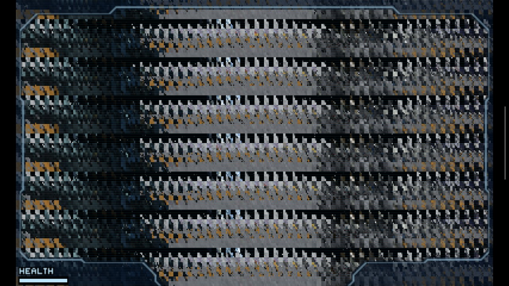
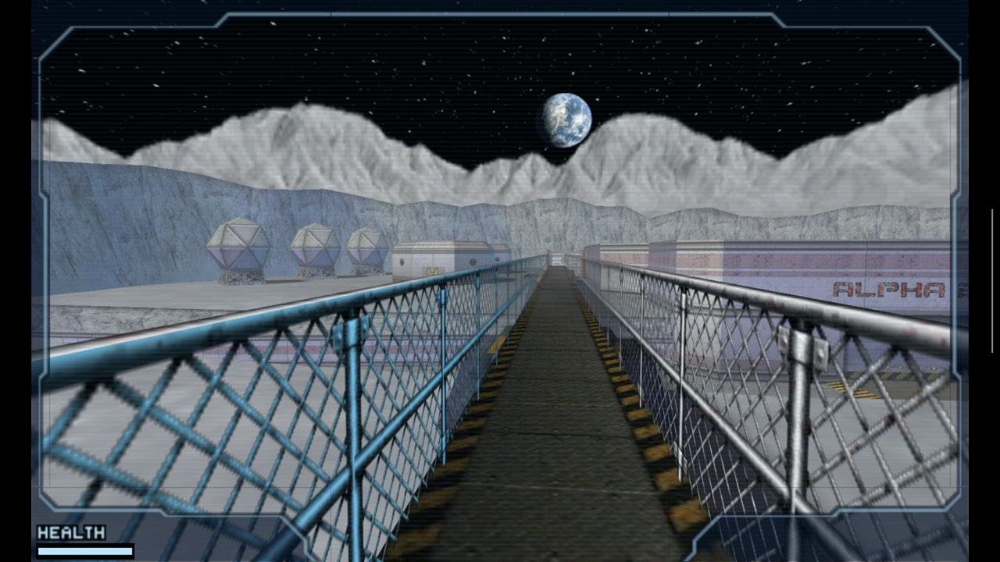

# Moon Chronicles fix for Azahar on Android (unofficial)

In [Azahar](https://github.com/azahar-emu/azahar) on Android, the 3D view of **Moon Chronicles** (Renegade Kid, Nintendo 3DS eShop) breaks into repeated horizontal bands from the first playable room on. The HUD, the text and the map on the lower screen look fine. This fork fixes it: the game renders correctly and runs at full speed.

| Official Azahar 2127.0-rc3 | This fork |
|---|---|
|  |  |

Both screenshots: first room of Episode 1, AYN Thor (Adreno 740, Android 13), Vulkan, 4x internal resolution.

**This build is not made or supported by the Azahar project.** Please don't report problems with it to them.

## Download and install

1. Download the APK from the [latest release](https://github.com/jdubz88/azahar-moon-chronicles-fix/releases/latest) (Android, arm64).
2. Install it. It appears as **Azahar Moonfix** and installs next to the official Azahar app instead of replacing it (package `io.github.lime3ds.android.moonfix`).
3. On first start, pick your existing Azahar user folder if you want to share settings, saves and installed titles with the official app, or a new folder.
4. Start Moon Chronicles from Azahar Moonfix.

Frontends that start games by intent (Daijishō, ES-DE, Cocoon and others) need the package name above; the game activity is `org.citra.citra_emu.activities.EmulationActivity`, as in official Azahar.

## When it happens

The banding shows on both renderers (Vulkan and OpenGL ES), at native resolution as well as upscaled, with the stock Qualcomm driver and with Turnip, and in Azahar 2126.2 as well as 2127.0-rc3. Stereoscopic, right-eye and shader settings make no difference. It is an emulator bug, so no setting fixes it.

## Cause

Each frame the game does the following. The addresses come from an instrumented build ([log excerpt](moonfix/log-excerpt.txt)):

1. It renders the scene into a 512x512 RGBA8 colour buffer at `0x18038400`.
2. Display transfer 1 copies that buffer, halving its width, into a linear 256x512 RGBA8 buffer at `0x18470400`.
3. Display transfer 2 copies the linear buffer into a tiled 256x512 **RGB8** texture at `0x18038400`.
4. It draws a full-screen quad, textured with that RGB8 texture (TEV stage 0: texture 0 times a constant), into its final 256x416 RGBA8 framebuffer at `0x18470400`, with the **alpha test on: a fragment passes only if its alpha is greater than 7**.

RGB8 has no alpha channel. Real hardware reads alpha as 1.0 when it samples an RGB8 texture, so every fragment passes and the quad covers the screen.

Azahar on Android keeps RGB8 surfaces in RGBA8 textures:

- **Vulkan**: Azahar maps RGB8 to `VK_FORMAT_B8G8R8_UNORM`. The Adreno driver does not support that format as a colour attachment, so Azahar falls back to `VK_FORMAT_R8G8B8A8_UNORM`.
- **OpenGL ES**: the RGB8 entry of `COLOR_TUPLES_OES` in `gl_texture_runtime.cpp` is `GL_RGBA8`.

Display transfer 2 runs on the GPU as a copy from the RGBA8 source, so the source's alpha, about 0, ends up in the texture. Sampling it returns alpha of about 0, every fragment fails the alpha test, and the quad draws nothing.

The bands come from the memory overlap. The final framebuffer at `0x18470400` lives in the same memory as the linear buffer from step 2. Before the draw, Azahar's rasterizer cache sees that this memory was last written as a linear surface. It refreshes the tiled framebuffer from it with a GPU readback and an upload. The linear picture read as tiled data is what shows on screen as horizontal bands.

Desktop OpenGL keeps RGB8 as `GL_RGB8`, which samples alpha as 1, so it is probably not affected. Desktop Vulkan uses the same RGBA8 fallback wherever a driver lacks 24-bit colour attachments, so it may show the same bug. Neither was tested.

## The fix

Every change is marked with a `Moonfix:` comment. The core patch on its own is [`moonfix/azahar-2127.0-rc3-moon-chronicles-fix.patch`](moonfix/azahar-2127.0-rc3-moon-chronicles-fix.patch).

### 1. Textures without alpha read alpha as 1 (all games)

When a surface's 3DS format has no alpha channel but its host texture is RGBA8, the texture is sampled with alpha forced to 1, as on the hardware.

- **Vulkan** (`src/video_core/renderer_vulkan/vk_texture_runtime.cpp` and `.h`): such handles get an `opaque_alpha` flag, and their sampling image view uses the component swizzle `a = ONE`. The framebuffer view (`Mip0`) is then no longer an alias of the sampling view. It is created on demand with the identity mapping, which Vulkan requires for attachments. This covers RGB8, and RGB565 when it too falls back to RGBA8.
- **OpenGL ES** (`src/video_core/renderer_opengl/gl_texture_runtime.cpp`): RGB8 textures created with the `GL_RGBA8` tuple get `GL_TEXTURE_SWIZZLE_A = GL_ONE`. Desktop OpenGL is unchanged.

This changes only what shaders read from these textures. Copies, blits, readbacks and rendering into these surfaces work as before, and nothing written back to emulated memory changes, because RGB8 and RGB565 have no alpha there.

### 2. Skip a wasted readback every frame (Moon Chronicles only)

With only fix 1 the picture is right, but the first room ran at 26 fps (43% speed) on Vulkan. Every frame the refresh described above reads the linear buffer back from the GPU and uploads it into the framebuffer, and then the full-screen quad overwrites all of it.

`RasterizerCache::ValidateByReinterpretation` (`src/video_core/rasterizer_cache/rasterizer_cache.h`) already skips this refresh when the two surfaces have different strides. This fork also skips it when they differ in tiled or linear layout. Skipping it could matter to other games, so it is switched on only for Moon Chronicles (USA, title ID `000400000012E700`), from `GPU::ApplyPerProgramSettings` in `src/video_core/gpu.cpp`, through the flag in `src/video_core/rasterizer_cache/moonfix.h`.

### Packaging

- App ID suffix `.moonfix` and the name "Azahar Moonfix", so the build installs next to the official app (`src/android/app/build.gradle.kts`, `src/android/app/src/*/res/values/strings.xml`).
- arm64 only, to keep build times down.
- `.github/workflows/moonfix-android.yml` builds the APK on GitHub Actions. Azahar's own workflows are switched off in this fork.

## Test results

AYN Thor (Snapdragon 8 Gen 2, Adreno 740, Qualcomm Vulkan driver 512.676.5, Android 13), 4x internal resolution:

| Build | First room of Episode 1 |
|---|---|
| Official Azahar 2127.0-rc3, Vulkan | horizontal bands, about 38 fps |
| Fix 1 only, Vulkan | correct picture, 26 fps (43% speed) |
| Fix 1 and 2 (this fork), Vulkan | correct picture, 62 fps, 0.4% late frames |
| Fix 1 and 2 (this fork), OpenGL ES | correct picture (speed not measured) |

## Limitations

- Only the first room of Episode 1 has been played with the fix. Later areas are untested.
- It was tested on one device, the AYN Thor.
- Fix 2 covers the USA release only (`000400000012E700`). Any other release gets fix 1, which corrects the picture, but not the speed fix.
- Fix 1 applies to every game. It makes Azahar read these textures the way the 3DS and desktop OpenGL do, but only a few other games have been spot-checked with it.
- The release APK is signed with a key generated by GitHub Actions for that build. A later build may be signed with a different key, and Android then refuses to install it over the old one. Uninstall first; your games and saves stay in the Azahar folder you picked.
- arm64 Android only.

## Building it yourself

This fork:

```sh
git clone --recursive -b moon-chronicles-fix https://github.com/jdubz88/azahar-moon-chronicles-fix
cd azahar-moon-chronicles-fix/src/android
./gradlew assembleGooglePlayRelease
```

This needs JDK 17 and the Android SDK and NDK; `.github/workflows/moonfix-android.yml` has the exact steps. You can also run that workflow in your own fork.

Another Azahar version: apply the patch with `git am moonfix/azahar-2127.0-rc3-moon-chronicles-fix.patch`. It was made against 2127.0-rc3 and touches six files in `src/video_core`, so later versions may need small adjustments.

## For Azahar developers

The cause was tracked down and the patch was written with the help of Claude, an AI model by Anthropic. Azahar's [AI policy](AI-POLICY.md) does not accept AI-written pull requests, so this is not submitted upstream. The cause above and the [log excerpt](moonfix/log-excerpt.txt) are meant to let anyone write their own fix.

## License

Azahar is licensed under the GPL, version 3 or later ([LICENSE.txt](LICENSE.txt)). This fork and its patch are under the same license. Moon Chronicles is © Renegade Kid; the screenshots only show the bug and the fix.
